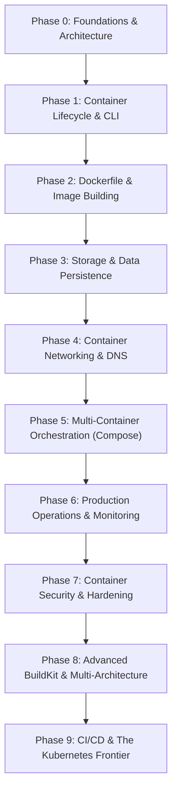

# Complete Docker Mastery Roadmap: From Zero to Advanced

This guide provides the complete prerequisites, system verification, and an exhaustive **0-to-Advanced Docker Roadmap** structured into sequential phases. No concepts have been left out—covering everything from core Linux container primitives to production hardening and multi-architecture CI/CD pipelines.

---

## 1. System Requirements & Setup Verification

### A. Current Machine Status
Based on a diagnostic check of your Windows machine:
- **Docker CLI**: Installed (`Docker version 28.4.0`).
- **WSL 2**: Installed and configured (`docker-desktop` distro present).
- **Daemon Status**: Currently stopped. You simply need to launch **Docker Desktop** from your Windows Start menu to start the background engine.

### B. Hardware & OS Requirements
| Component | Minimum | Recommended | Why it matters |
|---|---|---|---|
| **OS** | Windows 10/11 64-bit (Home, Pro, or Enterprise) | Windows 11 64-bit Pro/Home | Full WSL2 support and memory reclamation. |
| **CPU** | 64-bit processor with SLAT (Second Level Address Translation) | 4+ cores (Intel Core i5/i7/i9 or AMD Ryzen) | Docker runs Linux kernel virtualization. |
| **Virtualization** | Enabled in BIOS/UEFI (Intel VT-x or AMD-V) | Enabled | Mandatory for WSL2 and Hyper-V hypervisors. |
| **RAM** | 8 GB | 16 GB+ | Containers share host memory; multi-container setups require breathing room. |
| **Storage** | 20 GB free space | 50 GB+ free on SSD | Docker images, layers, and volumes consume disk quickly. |

### C. Recommended Tooling
1. **Docker Desktop for Windows**: Keep configured with the **WSL 2 backend** (Settings > General > *Use the WSL 2 based engine*).
2. **Terminal**: **Windows Terminal** (using PowerShell or WSL Ubuntu bash).
3. **Code Editor**: **Visual Studio Code** with extensions:
   - *Docker* (`ms-azuretools.vscode-docker`)
   - *Dev Containers* (`ms-vscode-remote.remote-containers`)
   - *WSL* (`ms-vscode-remote.remote-wsl`)
4. **Accounts**: A free [Docker Hub](https://hub.docker.com/) account for pushing and pulling custom images.

> [!WARNING]
> **OneDrive Sync Notice**: Your current folder is inside `OneDrive\Desktop\Docker`. OneDrive file-syncing can occasionally lock files or slow down heavy build contexts (like `node_modules` or local databases). To avoid issues, always configure `.dockerignore` files to exclude bulky temporary directories from the build context.

---

## 2. Recommended Folder Organization

Organize this workspace (`C:\Users\adika\OneDrive\Desktop\Docker`) into modular practice labs:

```text
Docker/
├── 01-foundations-and-cli/       # First containers, flags, logs, exec
├── 02-dockerfiles-and-images/    # Writing custom Dockerfiles, caching, CMD vs ENTRYPOINT
├── 03-storage-and-volumes/       # Bind mounts, named volumes, data persistence
├── 04-networking-and-dns/        # Bridge networks, service discovery, port exposing
├── 05-multi-stage-builds/        # Size optimization, Alpine, Distroless
├── 06-docker-compose/            # Multi-service apps (Web + API + DB + Cache)
├── 07-production-and-ops/        # Resource limits (CPU/RAM), health checks, log rotation
├── 08-security-and-hardening/    # Non-root users, read-only rootfs, vulnerability scanning
├── 09-advanced-buildx-cicd/      # Multi-arch images, BuildKit cache, GitHub Actions
└── notes/                        # Your personal cheat sheets and architecture notes
```

---

## 3. Exhaustive 0-to-Advanced Learning Roadmap



---

### Phase 0: Foundations & Architecture (Mental Model)
Before typing commands, understand how Docker works under the hood:
- **Virtual Machines vs. Containers**: Hypervisor vs. OS-level virtualization; why containers boot in milliseconds and share the host Linux kernel.
- **Linux Kernel Primitives**:
  - **Namespaces**: Process isolation (PID, NET, MNT, IPC, UTS, USER).
  - **Control Groups (Cgroups)**: Resource metering and limiting (CPU, Memory, I/O, Network).
  - **Union File System (UnionFS / Overlay2)**: Copy-on-Write (CoW) layering mechanism.
- **Docker Engine Architecture**:
  - Docker Client (CLI tool `docker`).
  - Docker Daemon (`dockerd` / Docker Desktop Linux VM).
  - Containerd & `runc` (OCI compliance).
  - Registries (Docker Hub, GitHub Container Registry, AWS ECR).
- **Core Distinction**: The difference between an **Image** (immutable blueprint/class) and a **Container** (running instance/object).

---

### Phase 1: Essential Container Lifecycle & CLI Commands
Master the commands to run, inspect, and debug containers:
- **Running Containers**:
  - `docker run [flags] [image] [command]`
  - Foreground vs. Detached mode (`-d`).
  - Interactive TTY terminal (`-it`).
  - Naming containers (`--name`) and auto-removal on exit (`--rm`).
  - Exposing and mapping ports (`-p <host_port>:<container_port>`).
  - Injecting environment variables (`-e KEY=VALUE`, `--env-file .env`).
- **Inspection & Diagnostics**:
  - Listing containers (`docker ps`, `docker ps -a`, `docker ps -q`).
  - Viewing real-time logs (`docker logs -f --tail 100 <container>`).
  - Executing commands inside a running container (`docker exec -it <container> sh`).
  - Detailed metadata inspection (`docker inspect <container>`).
  - Live resource consumption (`docker stats`).
  - Port mappings check (`docker port <container>`).
- **Lifecycle Management**:
  - Stopping and killing (`docker stop`, `docker kill`).
  - Pausing and unpausing (`docker pause`, `docker unpause`).
  - Deleting containers (`docker rm`, `docker rm -f $(docker ps -aq)`).
- **Working with Images**:
  - Pulling and searching (`docker pull`, `docker search`).
  - Listing and removing images (`docker images`, `docker rmi`).
  - Tagging images (`docker tag <source> <target>:<tag>`).
  - Pushing images to Docker Hub (`docker login`, `docker push`).

---

### Phase 2: Dockerfiles & Custom Image Creation
Learn how to package any programming language or application cleanly:
- **Dockerfile Directives**:
  - `FROM`: Choosing appropriate base images (Debian, Ubuntu, Alpine, Distroless).
  - `WORKDIR`: Setting execution directories (avoiding messy `cd` commands).
  - `COPY` vs. `ADD`: Differences, best practices, and tar extraction.
  - `RUN`: Executing build-time commands; combining steps with `&& \` to reduce layers.
  - `ENV` vs. `ARG`: Runtime environment variables vs. build-time build arguments.
  - `EXPOSE`: Documentation vs. actual runtime port binding.
  - `VOLUME`: Declaring managed mount points.
  - `USER`: Switching away from default `root`.
- **`CMD` vs. `ENTRYPOINT` (Crucial Nuance)**:
  - Shell form (`CMD node server.js`) vs. Exec form (`CMD ["node", "server.js"]`).
  - Creating CLI-like containers with `ENTRYPOINT` and default overridable args via `CMD`.
- **Build Context & Optimization**:
  - The Docker Build Context (`docker build -t my-app .`).
  - The `.dockerignore` file: Excluding `.git`, `node_modules`, `venv`, logs, and secrets.
  - Image layering and layer caching: Ordering instructions from least frequently changed to most frequently changed.

---

### Phase 3: Storage & Data Persistence
Containers are ephemeral by default. Understand how to persist data:
- **Storage Options**:
  - **Bind Mounts** (`-v /path/on/host:/path/in/container` or `--mount type=bind`): Ideal for local development (live code reload).
  - **Named Volumes** (`-v my-vol:/data` or `--mount type=volume`): Managed by Docker in `/var/lib/docker/volumes/`; best for database files and production persistence.
  - **Anonymous Volumes**: Ephemeral volume usage for caching or layer masking.
  - **`tmpfs` Mounts**: Storing sensitive data or high-throughput caches strictly in host memory (RAM), never written to disk.
- **Volume Management**:
  - `docker volume create`, `docker volume ls`, `docker volume inspect`, `docker volume rm`, `docker volume prune`.
- **Backup and Restore Strategies**:
  - Mounting volumes into a utility container to create `.tar.gz` backups and restoring them.
- **File Permissions**:
  - Handling UID/GID mismatch between host Windows/WSL users and container Linux users.

---

### Phase 4: Container Networking & Service Discovery
How containers communicate with each other, the host, and the outside internet:
- **Built-in Network Drivers**:
  - `bridge`: Default network on a single host.
  - `host`: Eliminates network isolation; container shares host network stack directly (Linux native).
  - `none`: Completely air-gapped network namespace with no external access.
  - `macvlan` / `ipvlan`: Assigning real physical LAN IP addresses to containers.
- **User-Defined Bridge Networks**:
  - `docker network create my-net`
  - Built-in DNS resolver: Connecting containers by container name rather than unstable IP addresses (`curl http://api-service:8080`).
  - Disconnecting and reconnecting running containers (`docker network connect/disconnect`).
- **Exposing vs. Publishing Ports**:
  - Internal communication inside the bridge vs. external binding (`-p 8080:80`).
- **Debugging Network Issues**:
  - `docker network inspect`
  - Using tools like `netstat`, `curl`, `nslookup`, `ping`, and `tcpdump` inside ephemeral debugging containers (`nicolaka/netshoot`).

---

### Phase 5: Multi-Stage Builds & Image Optimization
Shrink multi-gigabyte development images down to lightweight, production-ready artifacts:
- **The Multi-Stage Pattern**:
  - Stage 1: Build stage (SDKs, compilers, build dependencies, unit test runners).
  - Stage 2: Runtime stage (only the built binary or packaged code + minimal runtime).
  - Syntax: `FROM node:20 AS builder` followed by `COPY --from=builder /app/dist /app/dist`.
- **Choosing Minimal Base Images**:
  - Full OS (`ubuntu:24.04`, `debian:bookworm`): ~100MB+.
  - Slim (`python:3.12-slim`, `node:20-slim`): ~40-70MB.
  - Alpine (`alpine:3.20`): ~5MB (musl libc vs glibc considerations).
  - Distroless (`gcr.io/distroless/static-debian12`): No package manager, no shell, minimal attack surface.
  - `FROM scratch`: Pure static binaries (Go, Rust).
- **Targeting Stages**:
  - `docker build --target builder -t my-app:dev .`

---

### Phase 6: Multi-Container Orchestration with Docker Compose
Managing multi-tiered microservices as a single declarative unit:
- **`compose.yaml` (Docker Compose V2 Specification)**:
  - `services`: Defining containers, image/build directives, environment variables.
  - `ports` and `expose`.
  - `networks`: Connecting services to shared or isolated networks.
  - `volumes`: Defining named volumes and bind mounts.
  - `depends_on`: Startup ordering and condition gates (`condition: service_healthy`).
- **Environment & Configuration Management**:
  - Variable substitution with `.env`.
  - Multiple compose files and overrides (`docker compose -f compose.yaml -f compose.override.yaml up`).
  - Compose profiles (`profiles: ["debug", "frontend"]`).
- **Compose CLI Commands**:
  - `docker compose up -d`, `docker compose down -v`.
  - `docker compose ps`, `docker compose logs -f <service>`.
  - `docker compose exec <service> sh`.
  - `docker compose build --no-cache`.
  - `docker compose watch` (file synchronization for live dev).

---

### Phase 7: Production Operations, Health Checks & Observability
Running containers reliably in non-stop production environments:
- **Restart Policies**:
  - `no`, `always`, `on-failure[:max-retries]`, `unless-stopped`.
- **Container Health Checks**:
  - `HEALTHCHECK --interval=30s --timeout=5s --start-period=10s --retries=3 CMD curl -f http://localhost:8080/health || exit 1`.
  - Inspecting health status (`healthy`, `unhealthy`, `starting`).
- **Resource Governance**:
  - CPU quotas: `--cpus="1.5"`, `--cpu-shares`.
  - Memory ceilings: `-m 512m`, `--memory-reservation=256m`.
  - Understanding Linux OOM (Out Of Memory) killer triggers.
- **Logging Architecture**:
  - Logging drivers (`json-file`, `syslog`, `journald`, `fluentd`, `awslogs`).
  - Setting log rotation to avoid filling the disk (`max-size: "10m"`, `max-file: "3"`).
- **Housekeeping & Garbage Collection**:
  - `docker system df` (disk usage breakdown).
  - `docker system prune`, `docker system prune -a --volumes`.

---

### Phase 8: Container Security & Hardening
Securing images and runtimes against exploits:
- **Principle of Least Privilege**:
  - Creating and switching to a dedicated non-root user (`USER appuser`).
  - Preventing root privilege escalation (`--security-opt=no-new-privileges:true`).
- **Filesystem Hardening**:
  - Running with a read-only root filesystem (`--read-only`).
  - Pairing `--read-only` with explicit ephemeral `tmpfs` mounts for `/tmp` and `/var/run`.
- **Linux Capabilities (`cap-drop` / `cap-add`)**:
  - Dropping all capabilities: `--cap-drop=ALL`.
  - Adding back only what is needed: `--cap-add=NET_BIND_SERVICE`.
- **Vulnerability Scanning**:
  - Integrating `docker scout quickview`, `docker scout cves`.
  - Open-source vulnerability scanners: Trivy and Grype.
- **Secrets Management**:
  - Never baking API keys, passwords, or `.env` files into image layers.
  - Using Docker secrets or runtime environment injection from secret managers (Vault, AWS Secrets Manager).

---

### Phase 9: Modern BuildKit & Multi-Architecture Builds
Mastering modern build tooling for enterprise workflows:
- **BuildKit Features (`DOCKER_BUILDKIT=1`)**:
  - Parallel execution of independent build stages.
  - Secret mounting during build without leaving layer footprints: `RUN --mount=type=secret,id=npmrc ...`
  - Cache mounting for package managers (pip, npm, maven, go): `RUN --mount=type=cache,target=/root/.cache ...`
  - SSH key forwarding: `RUN --mount=type=ssh ...`
- **Multi-Architecture Images (Docker Buildx)**:
  - Building images that run natively on Intel/AMD (`linux/amd64`) and ARM (`linux/arm64` - Apple Silicon, AWS Graviton):
    ```bash
    docker buildx create --name multi-builder --use
    docker buildx build --platform linux/amd64,linux/arm64 -t username/app:v1 --push .
    ```
  - Inspecting manifest lists (`docker buildx imagetools inspect`).

---

### Phase 10: CI/CD Automation & The Path to Kubernetes
Putting Docker into automated pipelines and understanding where it fits in the modern cloud landscape:
- **CI/CD Integration**:
  - Automated build-test-scan-push workflows with **GitHub Actions** or **GitLab CI**.
  - Layer caching in CI using GitHub Actions cache or inline registry cache (`--cache-from`, `--cache-to`).
  - Semantic tagging (`v1.2.3`, `latest`, git commit SHA) and changelog hygiene.
- **The Container Ecosystem & OCI Standards**:
  - Open Container Initiative (OCI) image and runtime specifications.
  - Container runtimes: `containerd`, `CRI-O`, `runc`.
- **Docker to Kubernetes Transition**:
  - Docker Container vs. Kubernetes Pod.
  - Docker Compose vs. Kubernetes Helm Charts / Kustomize.
  - Running Docker-built images in Minikube, Kind, or managed cloud Kubernetes (EKS, GKE, AKS).

---

## 4. Immediate Day-1 Milestone: Get Your Hands Dirty

To confirm everything works immediately:
1. Open **Docker Desktop** on Windows. Wait until the whale icon in the taskbar turns solid (engine running).
2. Open PowerShell in this folder (`c:\Users\adika\OneDrive\Desktop\Docker`) and run:
   ```powershell
   # 1. Verify engine connection
   docker version

   # 2. Run your first container (verifies download, image extraction, and execution)
   docker run hello-world

   # 3. Spin up an interactive Linux container
   docker run -it --rm ubuntu:latest bash

   # 4. Spin up a detached Nginx web server and test port mapping
   docker run -d --name test-web -p 8080:80 nginx:alpine
   ```
3. Visit `http://localhost:8080` in your browser to see the default Nginx welcome page.
4. Clean up:
   ```powershell
   docker stop test-web
   docker rm test-web
   ```
